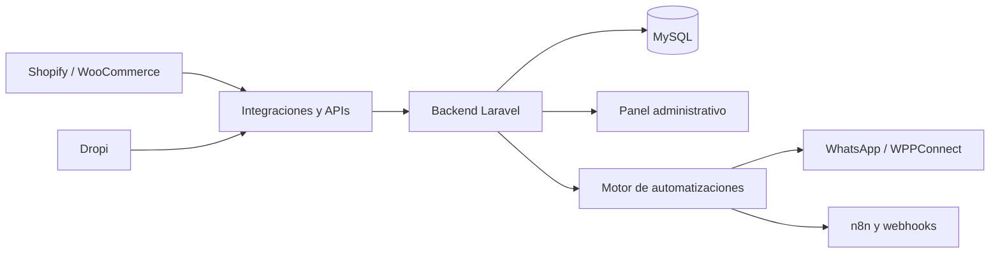

# Saviafem Admin — Plataforma de operaciones de e-commerce

**Caso de estudio · Full Stack · Laravel · Integraciones · Automatización**

Plataforma administrativa desarrollada para coordinar una operación real de comercio electrónico y dropshipping en Colombia. Centraliza información de pedidos, estados logísticos, mensajería y automatizaciones en una sola interfaz, evitando trabajar de forma fragmentada entre distintas herramientas.

> **Proyecto privado en producción.** Este repositorio es una presentación pública de las capacidades y el trabajo de ingeniería. No contiene el código fuente ni datos operativos.

## El problema que resuelve

La operación combina tiendas online, un proveedor logístico, mensajería con clientes, confirmaciones de pedidos y campañas de adquisición. Cuando estos procesos viven en sistemas separados, resulta más difícil consultar el estado de una venta, dar seguimiento al cliente y automatizar tareas repetitivas.

**Saviafem Admin** conecta esas piezas en una plataforma diseñada alrededor del flujo real del negocio.

## Funcionalidades principales

- **Panel operativo:** seguimiento de pedidos por etapa, métricas comerciales e indicadores de logística.
- **Gestión de pedidos:** consulta centralizada, productos, clientes y seguimiento de estados desde integraciones externas.
- **Integración con Dropi:** sincronización de pedidos y evolución de sus estados logísticos.
- **WhatsApp integrado:** bandeja de conversaciones y herramientas de atención desde el administrador, mediante WPPConnect.
- **Automatizaciones por eventos:** reglas para confirmaciones, generación de guías, entregas, reparto y abandono de compra.
- **Marketing y operación:** módulos para Meta Ads, ofertas, constructor UTM y plantillas de WhatsApp.
- **Conexión con otros sistemas:** Shopify, WooCommerce, Quick Order y servicios externos mediante APIs y webhooks.

## Capturas de la plataforma

### Vista general del administrador

El dashboard reúne indicadores operativos, estados de los pedidos y métricas comerciales en una vista de trabajo.

### Navegación y módulos

La estructura de navegación organiza las áreas de ventas, marketing, automatización y administración.

### Otras vistas del sistema

Estas capturas documentan diferentes pantallas de la plataforma. Las funcionalidades específicas se describen a continuación.

## Arquitectura conceptual

*Representación simplificada del ecosistema; no expone rutas internas, credenciales ni detalles de seguridad.*

## Tecnologías

| Área | Tecnologías |
| --- | --- |
| Backend | PHP, Laravel |
| Persistencia | MySQL |
| Integraciones | APIs, webhooks, Dropi, Shopify, WooCommerce |
| Mensajería | WhatsApp, WPPConnect |
| Automatización | Eventos de negocio, n8n |
| Infraestructura | Linux, VPS, Docker, despliegues y mantenimiento |

## Desafíos de ingeniería

**Sincronización entre plataformas.** Integrar fuentes de información diferentes y mantener una vista operativa coherente de pedidos y estados.

**Trazabilidad logística.** Registrar la evolución de los pedidos y facilitar el seguimiento desde el administrador.

**Mensajería contextual.** Conectar conversaciones de WhatsApp con información útil de pedidos y logística.

**Automatizaciones confiables.** Ejecutar reglas a partir de eventos de negocio, con controles para evitar comunicaciones indebidas durante procesos de sincronización.

**Operación en producción.** Administrar infraestructura, despliegues, registros y diagnóstico de incidencias de una aplicación utilizada en procesos comerciales reales.

## Desarrollo y orquestación de agentes de IA

El desarrollo combina experiencia Full Stack con herramientas de inteligencia artificial como **OpenCode, Codex y Claude Code** para apoyar implementación, revisión, depuración y evolución del sistema. La arquitectura, integración con procesos reales y validación en producción requieren criterio técnico y supervisión humana.

## Ecosistema de proyectos

Saviafem Admin se complementa con:

- **[Quick Order para Shopify](https://github.com/Cristian9518/quick-order-showcase):** aplicación con constructor visual, ofertas, checkout COD y webhooks.
- **Quick Order para WooCommerce:** plugin de checkout modal, promociones y ofertas por cantidad, desarrollado como solución privada.

## Privacidad y alcance

El código fuente, la configuración de producción, los datos de clientes y los secretos de integración no se publican. Las imágenes son material ilustrativo del producto; los valores que puedan aparecer corresponden a momentos puntuales y no representan resultados comerciales generales.

---

**Desarrollado por [Cristian Andrés Loaiza Flórez](https://github.com/Cristian9518)** · [LinkedIn](https://linkedin.com/in/cristian-loaiza-florez-64ba83246)
